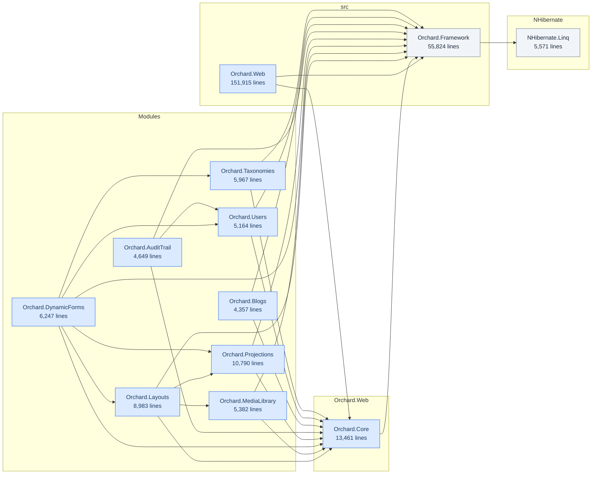

# orchard

A structural assessment, generated on 2026-10-20 by Legacy Lens.

Every number in this document was measured from the project files, the source
text and the change history. Nothing was estimated, and no part of it was
written by a language model. What could not be measured is listed at the end
rather than left out.

## At a glance

| Area | Verdict | Measured | Detail in |
|---|---|---|---|
| Project format | **to convert** | 89 of 89 in the old format, 16 convertible as they stand | What a move to modern .NET runs into |
| Packages with no future | **blocking** | 7 packages that exist only inside the .NET Framework; 73 of 89 projects reference one | What a move to modern .NET runs into |
| Packages nobody has classified | **unknown** | 78 of 93 distinct packages, counted as unknown rather than as fine | What a move to modern .NET runs into |
| Tests | **patchy** | no test project references 45 of the 78 projects that ship code, 75,908 lines | What will hurt |
| Package versions | **paid for once** | every package on one version today, 279 binding redirects written by hand | What a move to modern .NET runs into |
| Libraries tied to the web stack | **to separate** | 1 class library depends on the web stack | What will hurt |
| Change history | **read** | 449 files ranked on structure and churn over the full history | What will hurt |

**Read it with its limits.** 4 limits of this analysis apply to this codebase.
They are listed under "What this report does not say", at the end, and belong
next to any decision taken from this table.

## In short

orchard is 89 projects and 414,611 lines across 6,203 source files. Everything
targets v4.8. No test project references 45 of the 78 projects that ship code,
covering 75,908 lines. 449 files were ranked on structure and change frequency
together. The one at the top is
src/Orchard.Web/Modules/Orchard.OutputCache/Filters/OutputCacheFilter.cs. 89 of
89 project files are in the pre-SDK format. 73 projects reference packages that
exist only inside the .NET Framework, which no conversion tool will fix; 16
others are convertible as they stand. The work is ordered from what blocks
everything else through to what may cost nothing, and starts with: classify the
packages nobody has checked yet.

## What is already on your side

- 16 of 89 projects can take the modern project format as they stand: no package
  in them blocks it.
- 33 of the 78 projects that ship code are referenced by a test project, so a
  change there has something to fail against.
- Every one of the 93 distinct packages is pinned to a single version: nothing
  disagrees with itself today.
- 8 of the 93 distinct packages are known to run on modern .NET or to have a
  documented successor.
- 83% of the calls into Microsoft.AspNet.Mvc have a recorded counterpart in
  Microsoft.AspNetCore.Mvc.
- 58% of the calls into System.ServiceModel have a recorded counterpart in
  CoreWCF.Primitives.

## What this is

| Kind | Projects | Lines | Files |
|---|---:|---:|---:|
| Web application | 73 | 303,718 | 5,014 |
| Class library | 4 | 62,255 | 854 |
| Test project | 11 | 47,570 | 317 |
| Console application | 1 | 1,068 | 18 |
| **Total** | **89** | **414,611** | **6,203** |

The projects declare 319 dependencies on each other. Project kind is decided by
what sits in the folder rather than by which assemblies are referenced, because
references lie and a web.config next to a Views folder does not.

The 12 projects over 4,357 lines, and how they depend on each other. 77 projects
are left out: the test projects, and everything smaller than that. A diagram of
all 89 renders as a wall and tells a reader nothing.

The largest projects, which is where the time goes:

| Project | Kind | Target | Lines |
|---|---|---|---:|
| `Orchard.Web` | Web application | v4.8 | 151,915 |
| `Orchard.Framework` | Class library | v4.8 | 55,824 |
| `Orchard.Framework.Tests` | Test project | v4.8 | 23,163 |
| `Orchard.Core` | Web application | v4.8 | 13,461 |
| `Orchard.Projections` | Web application | v4.8 | 10,790 |
| `Orchard.Specs` | Test project | v4.8 | 10,069 |
| `Orchard.Tests.Modules` | Test project | v4.8 | 9,916 |
| `Orchard.Layouts` | Web application | v4.8 | 8,983 |
| `Orchard.DynamicForms` | Web application | v4.8 | 6,247 |
| `Orchard.Taxonomies` | Web application | v4.8 | 5,967 |

## Where the code is entered

627 entry points: every action, operation, handler, command and job a request, a
client or a schedule can reach. A flow through the code starts at one of these,
so this is the list of everything that can be traced. Test projects are left
out.

| Kind | Entry points | Projects |
|---|---:|---:|
| MVC action | 528 | 47 |
| Command-line command | 69 | 22 |
| Background or scheduled task | 14 | 13 |
| Remote procedure handler (XML-RPC) | 6 | 6 |
| Application event (Global.asax) | 3 | 1 |
| Web API action | 2 | 2 |
| HTTP handler | 2 | 1 |
| HTTP module | 1 | 1 |
| OWIN startup | 1 | 1 |
| Program entry (Main) | 1 | 1 |

Most entered: Orchard.Core (46), Orchard.Projections (35), Orchard.Users (35),
Orchard.Blogs (32), Upgrade (32), and 53 other projects. A framework that
dispatches through interfaces of its own, beyond the ones this tool knows, has
entry points this count does not include.

## What will hurt

| Finding | Count | Example |
|---|---:|---|
| Untested project | 45 | `NHibernate.Linq`: No test project references it (5,571 lines) |
| Oversized project | 3 | `Orchard.Framework.Tests`: 23,163 lines in one project |
| Library coupled to the web stack | 1 | `Orchard.Framework`: Library depends on System.Web.Http, System.Web.Http.WebHost, System.Web.Mvc, System.Web.WebPages, System.Web.WebPages.Deployment, System.Web.WebPages.Razor |
| Referenced by nothing | 1 | `MSBuild.Orchard.Tasks`: Nothing in the solution references it |

**Untested project.** Changes here are verified by running the application, or
not at all.

**Oversized project.** Past roughly 20,000 lines nobody holds the whole thing in
their head, and every change is made without seeing the consequences.

**Library coupled to the web stack.** It cannot be unit tested without a web
context, and cannot be reused from a service, a desktop client or a batch job.
Usually found out the day someone tries.

**Referenced by nothing.** Either dead code, or loaded at runtime by reflection
or a plugin mechanism, which the project files cannot show.

### The files most likely to break

Ranked on three signals that were all already on disk: complexity from the
syntax tree, change frequency from git over the full history, and whether a test
appears to cover the file. The score is the geometric mean of structure and
churn, so a file has to score high on both to reach the top: complicated but
never touched is not urgent, and touched constantly but trivial is not
dangerous. The score is a sort key, and the reasons beside it are the argument.
Generated code and everything inside a test project are left out rather than
ranked, because reporting that a test fixture is complicated and untested is
true and useless.

**The history window was widened.** Only 102 of this directory's 11677 commits
fall in the last 24 months, so the whole history was read instead. A window that
recent describes a codebase that has stopped changing by its tail.

| Score | File | Lines | Commits | Tested | Why |
|---:|---|---:|---:|---|---|
| 1.23 | `src/Orchard.Web/Modules/Orchard.OutputCache/Filters/OutputCacheFilter.cs` | 705 | 82 | **no** | changed in 82 commits; no test file appears to cover it |
| 1.23 | `src/Orchard.Web/Core/Shapes/CoreShapes.cs` | 866 | 79 | **no** | Pager_Links has a cyclomatic complexity of 34: covering its branches would take 34 tests; changed in 79 commits; no test file appears to cover it |
| 1.01 | `src/Orchard/ContentManagement/DefaultContentQuery.cs` | 386 | 44 | **no** | nested 6 levels deep; changed in 44 commits; no test file appears to cover it |
| 0.98 | `src/Orchard.Web/Modules/Orchard.Taxonomies/Services/TaxonomyService.cs` | 564 | 34 | **no** | changed in 34 commits; no test file appears to cover it |
| 0.97 | `src/Orchard/ContentManagement/DefaultHqlQuery.cs` | 724 | 28 | **no** | ToHql has a cyclomatic complexity of 23: covering its branches would take 23 tests; changed in 28 commits; no test file appears to cover it |
| 0.97 | `src/Orchard/Data/Migration/Interpreters/DefaultDataMigrationInterpreter.cs` | 407 | 43 | **no** | changed in 43 commits; no test file appears to cover it |
| 0.95 | `src/Orchard/ContentManagement/DefaultContentManager.cs` | 780 | 127 | yes | Get has a cyclomatic complexity of 25: covering its branches would take 25 tests; nested 7 levels deep; changed in 127 commits |
| 0.91 | `src/Orchard.Web/Modules/Upgrade/Controllers/InfosetController.cs` | 589 | 33 | **no** | changed in 33 commits; no test file appears to cover it |
| 0.89 | `src/Orchard.Web/Core/Contents/Controllers/AdminController.cs` | 499 | 119 | yes | changed in 119 commits |
| 0.87 | `src/Orchard/ContentManagement/Drivers/ContentPartDriver.cs` | 239 | 47 | **no** | changed in 47 commits; no test file appears to cover it |
| 0.87 | `src/Orchard.Web/Modules/Orchard.Blogs/Controllers/BlogPostAdminController.cs` | 252 | 48 | **no** | changed in 48 commits; no test file appears to cover it |
| 0.86 | `src/Orchard/Environment/ShellBuilders/ShellContainerFactory.cs` | 301 | 35 | **no** | CreateContainer has a cyclomatic complexity of 35: covering its branches would take 35 tests; nested 6 levels deep; changed in 35 commits; no test file appears to cover it |
| 0.86 | `src/Orchard.Web/Modules/Orchard.Users/Controllers/AccountController.cs` | 612 | 88 | yes | changed in 88 commits |
| 0.85 | `src/Orchard.Web/Modules/Orchard.ContentTypes/Services/ContentDefinitionService.cs` | 354 | 46 | **no** | changed in 46 commits; no test file appears to cover it |
| 0.85 | `src/Orchard.Web/Modules/Orchard.Azure/Services/FileSystems/AzureFileSystem.cs` | 419 | 28 | **no** | changed in 28 commits; no test file appears to cover it |

## What a move to modern .NET runs into

| | Count |
|---|---:|
| Projects | 89 |
| In the old project format | 89 |
| Convertible as they stand | 16 |
| Blocked by a package with no path forward | 73 |
| Package references in total | 722 |
| Distinct packages | 93 |
| Pinned to more than one version | 0 |
| Hand-written binding redirects | 279 |

**This legacy has drifted.** Every package is pinned to a single version today,
but 279 binding redirects were written by hand. A redirect only ever gets
written because two assemblies disagreed, so they are the trace of drift that
has already been paid for once. Old and drifted is a different job from old but
coherent, and the difference belongs in the price rather than in the reader's
head.

Packages that exist only inside the .NET Framework:

| Package | Projects |
|---|---:|
| `Microsoft.AspNet.Mvc` | 73 |
| `Microsoft.AspNet.Razor` | 73 |
| `Microsoft.AspNet.WebPages` | 73 |
| `Microsoft.Web.Infrastructure` | 73 |
| `Microsoft.CodeDom.Providers.DotNetCompilerPlatform` | 61 |
| `Microsoft.Owin.Host.SystemWeb` | 5 |
| `Microsoft.AspNet.WebApi.WebHost` | 1 |

No version of these runs on modern .NET, so no conversion tool will help. The
code that calls them is rewritten, replaced, or left where it is.

78 packages are reported as unclassified rather than assumed to be fine. Naming
a package portable without checking is how a quote acquires the one item that
doubles it.

## What you actually use of what is going away

A package with no future is not a unit of work. What decides the size is how
much of it this codebase touches and how few types carry it: a hundred calls
through six types is an afternoon, and the same hundred spread over sixty is a
rewrite. Counted from the syntax, so a type is counted where it appears in a
type position in a file importing the package and nothing in the solution
declares it. Every type of every package is listed in the appendix.

| Package | Calls | Types | Files | Types for four fifths | Replaced by | Covered |
|---|---:|---:|---:|---:|---|---:|
| `Microsoft.AspNet.Mvc` | 3,619 | 185 | 365 | 24 | `Microsoft.AspNetCore.Mvc` | 83% |
| `Autofac` | 790 | 99 | 159 | 28 | nothing recorded |  |
| `Newtonsoft.Json` | 510 | 23 | 31 | 4 | `System.Text.Json` | 0% |
| `NHibernate` | 462 | 79 | 58 | 25 | nothing recorded |  |
| `Microsoft.AspNet.WebApi.Core` | 92 | 38 | 13 | 23 | `Microsoft.AspNetCore.Mvc` | 7% |
| `log4net` | 79 | 20 | 6 | 7 | `Serilog` | 4% |
| `Microsoft.AspNet.WebPages` | 62 | 25 | 11 | 14 | `Microsoft.AspNetCore.Mvc.Razor` | 18% |
| `System.ServiceModel` | 40 | 16 | 4 | 8 | `CoreWCF.Primitives` | 58% |
| `Owin` | 19 | 10 | 10 | 7 | nothing recorded |  |
| `Microsoft.AspNet.Razor` | 6 | 6 | 1 | 5 | nothing recorded |  |

### Microsoft.AspNet.Mvc

3,619 uses of 185 types, across 365 files. 24 types and 134 files carry four
fifths of it. **Microsoft.AspNetCore.Mvc** covers 83% of those calls; 543 calls
are not in the catalogue at all: unknown, which is not the same as fine.

Asked of the framework itself rather than of the catalogue, the unknown column
holds 7 types that exist inside Microsoft.AspNetCore.Mvc under the same name, a
lead worth checking; 12 types that exist elsewhere in the framework under the
same name, which nobody has recorded either way; and 97 types the framework does
not have at all. That leaves 109 types still to decide.

| Type | Calls | What happens to it |
|---|---:|---|
| `ActionResult` | 541 | replaced in Microsoft.AspNetCore.Mvc |
| `HttpUnauthorizedResult` | 408 | replaced in Microsoft.AspNetCore.Mvc |
| `HttpPost` | 260 | replaced in Microsoft.AspNetCore.Mvc |
| `RequestContext` | 59 | unknown; same name at `ModelContextProtocol.Server.RequestContext` |
| `ValidateInput` | 57 | **deleted**: the feature was withdrawn |
| `HttpContext` | 8 | unknown; same name at `Microsoft.AspNetCore.Http.HttpContext` |
| `IRouteHandler` | 5 | unknown; same name at `Microsoft.AspNetCore.Routing.IRouteHandler` |
| `VirtualPathData` | 5 | unknown; same name at `Microsoft.AspNetCore.Routing.VirtualPathData` |
| `IModule` | 4 | unknown; same name at `ICSharpCode.Decompiler.TypeSystem.IModule` |
| `OutputCacheAttribute` | 3 | **no replacement recorded** |
| `HttpRequest` | 3 | unknown; same name at `Microsoft.AspNetCore.Http.HttpRequest` |
| `IRouteConstraint` | 2 | unknown; same name at `Microsoft.AspNetCore.Routing.IRouteConstraint` |
| `RouteDirection` | 2 | unknown; same name at `Microsoft.AspNetCore.Routing.RouteDirection` |
| `HandleErrorAttribute` | 1 | **no replacement recorded** |
| `IDependencyResolver` | 1 | **no replacement recorded** |

### Autofac

790 uses of 99 types, across 159 files. 28 types and 67 files carry four fifths
of it. Nobody has recorded what replaces this. That is a gap in the catalogue
rather than a statement about the package.

### Newtonsoft.Json

510 uses of 23 types, across 31 files. 4 types and 2 files carry four fifths of
it. **System.Text.Json** covers 0% of those calls; 91 calls are not in the
catalogue at all: unknown, which is not the same as fine.

Asked of the framework itself rather than of the catalogue, the unknown column
holds 0 types that exist inside System.Text.Json under the same name, a lead
worth checking; 7 types that exist elsewhere in the framework under the same
name, which nobody has recorded either way; and 10 types the framework does not
have at all. That leaves 17 types still to decide.

| Type | Calls | What happens to it |
|---|---:|---|
| `JProperty` | 243 | **no replacement recorded** |
| `JObject` | 114 | **no replacement recorded** |
| `JArray` | 38 | **no replacement recorded** |
| `JToken` | 22 | **no replacement recorded** |
| `ActionResult` | 17 | unknown; same name at `Microsoft.AspNetCore.Mvc.ActionResult` |
| `HtmlString` | 12 | unknown; same name at `Microsoft.AspNetCore.Html.HtmlString` |
| `Controller` | 3 | unknown; same name at `Microsoft.AspNetCore.Mvc.Controller` |
| `FormCollection` | 3 | unknown; same name at `Microsoft.AspNetCore.Http.FormCollection` |
| `JValue` | 1 | **no replacement recorded** |
| `JsonResult` | 1 | unknown; same name at `Microsoft.AspNetCore.Mvc.JsonResult` |
| `RouteData` | 1 | unknown; same name at `Microsoft.AspNetCore.Routing.RouteData` |
| `SelectListItem` | 1 | unknown; same name at `Microsoft.AspNetCore.Mvc.Rendering.SelectListItem` |

### NHibernate

462 uses of 79 types, across 58 files. 25 types and 28 files carry four fifths
of it. Nobody has recorded what replaces this. That is a gap in the catalogue
rather than a statement about the package.

### Microsoft.AspNet.WebApi.Core

92 uses of 38 types, across 13 files. 23 types and 7 files carry four fifths of
it. **Microsoft.AspNetCore.Mvc** covers 7% of those calls; 82 calls are not in
the catalogue at all: unknown, which is not the same as fine.

Asked of the framework itself rather than of the catalogue, the unknown column
holds 5 types that exist inside Microsoft.AspNetCore.Mvc under the same name, a
lead worth checking; 6 types that exist elsewhere in the framework under the
same name, which nobody has recorded either way; and 22 types the framework does
not have at all. That leaves 28 types still to decide.

| Type | Calls | What happens to it |
|---|---:|---|
| `ContainerBuilder` | 8 | unknown to the catalogue |
| `ILifetimeScope` | 6 | unknown to the catalogue |
| `IHttpController` | 5 | unknown to the catalogue |
| `RouteCollection` | 5 | unknown; same name at `Microsoft.AspNetCore.Routing.RouteCollection` |
| `HttpConfiguration` | 4 | **no replacement recorded** |
| `IModule` | 3 | unknown; same name at `ICSharpCode.Decompiler.TypeSystem.IModule` |
| `KeyedService` | 2 | unknown; same name at `Microsoft.Extensions.DependencyInjection.KeyedService` |
| `RequestContext` | 1 | unknown; same name at `ModelContextProtocol.Server.RequestContext` |
| `RouteBase` | 1 | unknown; same name at `Microsoft.AspNetCore.Routing.RouteBase` |
| `RouteData` | 1 | unknown; same name at `Microsoft.AspNetCore.Routing.RouteData` |

5 further packages in the table above are not detailed here; their types are in
the appendix.

## What there is to decide about the frameworks themselves

The names nothing accounts for come to 4 questions. What follows is what each
one was for, what replaced it, and what there is to choose between. None of the
options is a recommendation: which one is right depends on how many people, how
much time, and whether the old and the new have to run side by side, and none of
that is in the code.

**The request context.** 109 calls through `RequestContext`, `HttpContextBase`,
`HttpRequestBase`, `HttpResponseBase`, `HttpCookieCollection`,
`HttpContextWrapper`, and 3 more.

System.Web wrapped the request in a family of abstract base classes so that code
could be tested against them, and passed one around as the ambient state of the
request. ASP.NET Core has HttpContext and its parts, injected rather than
ambient, with different names and a different shape. An uploaded file is
IFormFile, cookies are IRequestCookieCollection, and there is no HttpException.

- Move the code onto the new types directly. Shortest where the class already
receives the context as an argument.
- Put an interface of your own in front of what you actually use, and implement
it over the new types. Longest, and the only option that lets the old and the
new code run side by side.
- Push the context out of the class entirely and pass the values it reads. Turns
a migration into a design change, which is sometimes the right trade and never a
small one.

**Pipeline internals.** 72 calls through `MvcRouteHandler`, `HttpApplication`,
`MvcHandler`, `ControllerBuilder`, `ReflectedControllerDescriptor`.

Code that reached into how MVC found controllers, resolved views or handled the
application lifetime. Global.asax is the usual entry point. There is no
equivalent, and that is deliberate: the pipeline is middleware you compose in
Program.cs rather than handlers you replace.

- Find what the code was working around and check whether the new pipeline does
it already. Most of these predate features the framework grew.
- Write it as middleware, which is where the behaviour belongs now.
- Treat it as a rewrite of that concern, and price it as one. This is the group
that genuinely costs.

**Areas.** 7 calls through `IRouteWithArea`.

An area registered itself by deriving from AreaRegistration, and the framework
found it by scanning assemblies at startup. Areas still exist and there is
nothing to register: a controller carries [Area] and routes name it.

- Delete the registration classes and put [Area] on the controllers.
- Ask first whether the areas earn their keep, because the routing they were
working around is gone.

**Model binding extensibility.** 6 calls through `ModelBinderDictionary`,
`DefaultModelBinder`.

Binding was extended by deriving from the default binder or replacing the
metadata provider, both of which knew a great deal about the pipeline around
them. ASP.NET Core binds through IModelBinder and IModelBinderProvider,
registered in options. The shape is similar and the base classes are not there
to derive from.

- Write the binder against the new interfaces. Usually smaller than the
original, because the default no longer has to be reimplemented around it.
- Check first whether the framework now does it. Several of these existed to
bind types that bind on their own today.

## What only you can decide

Everything below came out of preparing the mechanical work, and none of it can
be settled by reading the code harder. They are listed before the order because
the order assumes them.

**73 projects, one shown.** Still depends on packages with no path to modern
.NET: Microsoft.AspNet.Mvc, Microsoft.AspNet.Razor,
Microsoft.AspNet.WebApi.WebHost, Microsoft.AspNet.WebPages,
Microsoft.Web.Infrastructure. This changes the file format and not the future of
the project.

Orchard.Framework, Orchard.Specs, Orchard.Tests.Modules,
Orchard.Framework.Tests, Orchard.Core.Tests, Orchard.ContentTypes, and 67 more.

**Across the solution.** 1 key(s) are declared in more than one config file with
different values, and the last one read wins here:
aspnet:RoslynCompilerLocation. Which one was right at runtime depended on which
application loaded them, and that is not something these files record.

**Across the solution.** 1 key(s) are read by the code and declared nowhere.
They are not in this file either, because inventing a value is the one thing
that would make it wrong.

## In what order

This is a dependency order, not a schedule, and it deliberately carries no days:
nothing here measured how fast anyone works. What it does carry is a property of
the codebase. Work that blocks the rest comes first, because the report itself
is unreliable while it stands. Mechanical work comes before decisions, because
it is the half nobody has to argue about and doing it shrinks the surface the
arguments are about.

| Step | What | Kind | How much |
|---:|---|---|---|
| 1 | Classify the packages nobody has checked yet | Needed before anyone can price the rest | 78 packages |
| 2 | Convert the project files that can take the modern format | Mechanical, no decision required | 13 projects |
| 3 | Retire the hand-written binding redirects | Mechanical, no decision required | 279 redirects |
| 4 | Decide what happens to the code built on System.Web | Needs a decision, not a tool | 73 projects |
| 5 | Separate the libraries that depend on the web stack | Needs a decision, not a tool | 1 library |
| 6 | Put tests around the files most likely to break | Never finished, only kept up | 20 files |
| 7 | Confirm whether the unreferenced projects are dead | May cost nothing | 1 project |

### 1. Classify the packages nobody has checked yet

*Needed before anyone can price the rest. 78 packages.*

These are neither known to work on modern .NET nor known to be dead ends. Each
one is either a non-event or a rewrite, and which of the two decides the size of
everything below. Quoting before they are classified means quoting on the
assumption that none of them is a problem. What it covers is listed in the appendix.

### 2. Convert the project files that can take the modern format

*Mechanical, no decision required. 13 projects.*

Only the file format is old, and the conversion is a tool run and a review. It
is worth doing first because it shrinks what everything after this has to work
through. Some of these still depend on packages with no path forward: that is a
separate problem and the format change does not pretend to fix it. What comes
out is a patch that applies, and whether the solution restores and compiles
afterwards is for the build to say, not for this. What it covers is listed in the appendix.

### 3. Retire the hand-written binding redirects

*Mechanical, no decision required. 279 redirects.*

A redirect only ever gets written because two assemblies disagreed about a
version. The project files no longer show the disagreement, which means the
redirects are load-bearing: removing one at conversion time is how a migration
acquires a runtime failure that nothing in the build predicted.

### 4. Decide what happens to the code built on System.Web

*Needs a decision, not a tool. 73 projects.*

7 packages here exist only inside the .NET Framework. No version of them runs on
modern .NET, so no conversion tool will help: the code that calls them is
rewritten, replaced, or left where it is. That is a decision about the product,
not about the code, and it is the one that decides whether the rest is a
migration or a rewrite. What it covers is listed in the appendix.

### 5. Separate the libraries that depend on the web stack

*Needs a decision, not a tool. 1 library.*

A library holding a web dependency cannot be tested without a web context, and
cannot be reused from a service, a desktop client or a batch job. It is listed
after the decision above because what the web layer becomes decides how much of
this is worth untangling. What it covers is listed in the appendix.

### 6. Put tests around the files most likely to break

*Never finished, only kept up. 20 files.*

No test project references 45 projects in this solution. The files below are the
ones where that matters most: they rank highest on complexity and change
frequency together, which is the combination that produces incidents. This is
the one item here that is never finished, which is why it starts early and runs
alongside the rest. What it covers is listed in the appendix.

### 7. Confirm whether the unreferenced projects are dead

*May cost nothing. 1 project.*

Nothing in the solution references these. They are either dead code, which makes
them the cheapest work in this report, or they are loaded at runtime by
reflection or a plugin mechanism, which project files cannot show. Someone who
knows the product answers this in minutes. What it covers is listed in the appendix.

## What this report does not say

Printed here rather than left for the reader to discover after acting on it.
Each of these applies to this codebase; the ones that did not apply were left
out.

**Nothing was compiled.** The whole report is read from project files, source
text and git. That is what lets it run on a solution that does not build, which
is the state most inherited code is in. The cost is that anything resolved at
runtime, by reflection, dependency injection or a plugin loader, is invisible
here.

**Test coverage is a naming convention.** A file is counted as tested when a
test file appears to be named after it. That over-reports coverage and never
under-reports it: a file called untested here is genuinely untested, while one
called tested may only share a name with a test that exercises none of it.

**Most packages are unclassified.** 78 of 93 distinct packages are neither known
to run on modern .NET nor known to be dead ends. They are reported as unknown
rather than assumed to be fine, because a survey that quietly counts an unknown
package as portable is one that discovers the problem after the price has been
agreed.

**Generated code was excluded.** 31 generated files were left out of the
ranking. They top every chart on size and complexity and tell a reader nothing
they can act on, but they are still code that ships, and a regeneration path
that no longer exists is its own problem.

## Appendix: every type used, by package

For the engineer doing the work. Each package with its types, heaviest first,
and the number of calls in brackets.

**Microsoft.AspNet.Mvc, 185 types.** `ActionResult` (541),
`HttpUnauthorizedResult` (408), `HttpPost` (260), `RouteValueDictionary` (194),
`SelectListItem` (172), `HtmlHelper` (167), `ActionName` (134), `Controller`
(131), `IHtmlString` (127), `UrlHelper` (105), `MvcHtmlString` (70), `Route`
(63), `RequestContext` (59), `MvcRouteHandler` (58), `ValidateInput` (57),
`TagBuilder` (51), `Mock` (46), `ControllerContext` (43), `HtmlString` (41),
`ViewContext` (41), `IViewDataContainer` (39), `JsonResult` (35), `IViewEngine`
(34), `RouteCollection` (34), `RouteData` (34), `ContainerBuilder` (28),
`HttpContextBase` (28), `FormCollection` (27), `ViewDataDictionary` (23),
`IValueProvider` (19), `RouteBase` (17), `ModelStateDictionary` (16),
`ActionExecutingContext` (15), `ResultExecutedContext` (15),
`ResultExecutingContext` (15), `ViewEngineResult` (15), `ILifetimeScope` (14),
`IResultFilter` (14), `ViewResult` (12), `ActionExecutedContext` (10),
`AuthorizationContext` (10), `DictionaryValueProvider` (10), `IView` (10),
`RedirectResult` (9), `HttpContext` (8), `TagRenderMode` (8), `ControllerBase`
(7), `HtmlTextWriter` (7), `IActionFilter` (7), `IComponentContext` (7),
`IHttpHandler` (7), `IRouteWithArea` (7), `RedirectToRouteResult` (7),
`HttpApplication` (6), `HttpNotFoundResult` (6), `MvcForm` (6), `SelectList`
(6), `Bind` (5), `HttpRequestBase` (5), `HttpResponseBase` (5), `IRouteHandler`
(5), `JObject` (5), `Meta` (5), `NamedParameter` (5), `TempDataDictionary` (5),
`ViewResultBase` (5), `VirtualPathData` (5), `WebPageBase` (5), `Authorize` (4),
`ConfigurationSettingsReader` (4), `ContentResult` (4), `ExceptionContext` (4),
`HiddenInput` (4), `HttpCookieCollection` (4), `HttpStatusCodeResult` (4),
`IModelBinder` (4), `IModule` (4), `ModelBinderDictionary` (4),
`ModelBindingContext` (4), `SessionStateBehavior` (4), `ValueProviderResult`
(4), `WebPageContext` (4), `ConcreteReflectionActivatorData` (3),
`ControllerBuilder` (3), `EmptyResult` (3), `FormMethod` (3),
`HttpContextWrapper` (3), `HttpRequest` (3), `IAuthorizationFilter` (3),
`IComponentRegistry` (3), `IHttpAsyncHandler` (3), `IRegistrationBuilder` (3),
`MvcHandler` (3), `OutputCacheAttribute` (3), `RazorViewEngine` (3),
`SelectListGroup` (3), `SingleRegistrationStyle` (3), `TemplateControl` (3),
`TemplateInfo` (3), `ViewEngineCollection` (3), `ActionMethodSelectorAttribute`
(2), `Cell` (2), `CellValues` (2), `DefaultControllerFactory` (2),
`DefaultModelBinder` (2), `EnumValue` (2), `FileContentResult` (2), `Filter`
(2), `HelperResult` (2), `HttpBrowserCapabilitiesBase` (2), `HttpRequestWrapper`
(2), `HttpServerUtilityBase` (2), `HttpSessionStateBase` (2),
`IComponentRegistration` (2), `IExceptionFilter` (2), `IHttpController` (2),
`IRequiresSessionState` (2), `IRouteConstraint` (2), `InlineString` (2),
`JArray` (2), `NameValueCollectionValueProvider` (2), `OutputCache` (2),
`PageInstrumentationService` (2), `ReflectedControllerDescriptor` (2),
`RequireHttpsAttribute` (2), `ResizeSettings` (2), `RouteDirection` (2),
`SmtpSection` (2), `WebPageRenderingBase` (2), `ActionFilterAttribute` (1),
`AuthenticationChallengeContext` (1), `AuthenticationContext` (1),
`AuthenticationProperties` (1), `BodyBuilder` (1), `CacheDependency` (1),
`DataAnnotationsModelValidatorProvider` (1), `ExceptionFilterAttribute` (1),
`FileResult` (1), `FilterAttribute` (1), `HandleError` (1),
`HandleErrorAttribute` (1), `HttpActionExecutedContext` (1),
`HttpAntiForgeryException` (1), `HttpControllerContext` (1), `HttpException`
(1), `HttpGet` (1), `HttpResponse` (1), `HttpTaskAsyncHandler` (1),
`IAuthenticationFilter` (1), `IContainerProvider` (1), `IDependencyResolver`
(1), `IHttpControllerActivator` (1), `IHttpControllerSelector` (1), `IHttpRoute`
(1), `IHttpRouteData` (1), `IInterceptor` (1), `IInvocation` (1), `IPackage`
(1), `IPackageRepository` (1), `ISession` (1), `IViewLocationCache` (1),
`JProperty` (1), `KeyedService` (1), `LifetimeScope` (1), `MailboxAddress` (1),
`MembershipCreateStatus` (1), `MimeMessage` (1), `ModelMetadata` (1),
`ModelValidator` (1), `OutputCacheLocation` (1), `PackageSource` (1),
`PartialViewResult` (1), `RangeAttributeAdapter` (1),
`RegularExpressionAttributeAdapter` (1), `RequiredAttributeAdapter` (1), `Sheet`
(1), `SheetData` (1), `Sheets` (1), `StopRoutingHandler` (1),
`StringLengthAttributeAdapter` (1), `ValidateAntiForgeryTokenAttribute` (1),
`WebFormViewEngine` (1), `Workbook` (1), `Worksheet` (1), `ZipPackage` (1).

**Autofac, 99 types.** `ContainerBuilder` (144), `Mock` (127), `ILifetimeScope`
(60), `IComponentRegistration` (34), `HttpContextBase` (24), `RequestContext`
(22), `HtmlString` (21), `IComponentContext` (17), `MvcRouteHandler` (16),
`ISession` (15), `ISessionFactory` (15), `Route` (15), `RouteCollection` (15),
`IComponentRegistry` (13), `RouteData` (11), `Service` (10), `UrlHelper` (10),
`IRegistrationBuilder` (8), `ZipPackage` (8), `InstanceContext` (6),
`NamedParameter` (6), `ConcreteReflectionActivatorData` (5), `Controller` (5),
`HttpApplication` (5), `IHttpController` (5), `IModule` (5), `Meta` (5),
`RouteValueDictionary` (5), `TypedParameter` (5), `ConfigurationSettingsReader`
(4), `ControllerContext` (4), `HttpConfiguration` (4), `HttpContext` (4),
`HttpControllerContext` (4), `HttpControllerDescriptor` (4),
`HttpCookieCollection` (4), `HttpRequestBase` (4), `ICriteria` (4),
`KeyedService` (4), `RedirectToRouteResult` (4), `ServiceHostBase` (4),
`ViewContext` (4), `ControllerBuilder` (3), `DefaultProxyBuilder` (3),
`IDependencyScope` (3), `IRegistrationSource` (3), `IServiceWithType` (3),
`MockBehavior` (3), `RouteBase` (3), `ServiceDescription` (3), `ServiceEndpoint`
(3), `SingleRegistrationStyle` (3), `TypedService` (3), `ChannelDispatcher` (2),
`ContentResult` (2), `DefaultControllerFactory` (2),
`HttpBrowserCapabilitiesBase` (2), `HttpResponseBase` (2),
`HttpServerUtilityBase` (2), `HttpSessionStateBase` (2), `IContainerProvider`
(2), `IDependencyResolver` (2), `IHttpControllerActivator` (2),
`IHttpControllerSelector` (2), `IHttpHandler` (2), `IInterceptor` (2),
`IInvocation` (2), `IPackage` (2), `ModelBinderDictionary` (2),
`ModelStateDictionary` (2), `PageInstrumentationService` (2), `RedirectResult`
(2), `ScanningActivatorData` (2), `ServiceHost` (2), `ViewEngineCollection` (2),
`BindingParameterCollection` (1), `ControllerBase` (1),
`DefaultHttpControllerSelector` (1), `DistinctRootEntityResultTransformer` (1),
`HiddenInput` (1), `HtmlHelper` (1), `HttpContextWrapper` (1), `HttpRequest`
(1), `HttpResponse` (1), `IAppender` (1), `IDisposer` (1), `IExtension` (1),
`IInstanceProvider` (1), `IProxyBuilder` (1), `IServiceBehavior` (1),
`ITransaction` (1), `LifetimeScope` (1), `LoggingEvent` (1), `Message` (1),
`MvcHandler` (1), `PositionalParameter` (1), `ServiceHostFactory` (1),
`ViewResult` (1), `WebFormViewEngine` (1).

**Newtonsoft.Json, 23 types.** `JProperty` (243), `JObject` (114), `JArray`
(38), `JToken` (22), `ActionResult` (17), `HttpUnauthorizedResult` (16),
`HtmlString` (12), `HttpPost` (11), `ActionName` (7),
`FormsAuthenticationTicket` (7), `HttpCookie` (5), `Controller` (3),
`FormCollection` (3), `FormsIdentity` (2), `ValidateInput` (2),
`ConnectionMultiplexer` (1), `Formatting` (1), `HttpContextBase` (1),
`IDatabase` (1), `JValue` (1), `JsonResult` (1), `RouteData` (1),
`SelectListItem` (1).

**NHibernate, 79 types.** `ICriteria` (76), `ISession` (50), `ICriterion` (30),
`Mock` (29), `ISessionFactory` (25), `Configuration` (23), `ContainerBuilder`
(17), `IProjection` (16), `IType` (12), `DetachedCriteria` (11), `CriteriaImpl`
(10), `ICriteriaQuery` (8), `ITransaction` (8), `FluentConfiguration` (6),
`LinqExpression` (6), `Conjunction` (5), `IPersistenceConfigurer` (5),
`ISQLFunction` (5), `JoinType` (5), `SchemaExport` (5), `AutoPersistenceModel`
(4), `IResultTransformer` (4), `ISessionFactoryImplementor` (4),
`SimpleExpression` (4), `SqlFunctionProjection` (4), `TypedValue` (4),
`VarArgsSQLFunction` (4), `Dialect` (3), `IDiagnosticLogger` (3),
`IEntityPersister` (3), `ISessionImplementor` (3), `ITypeSource` (3), `Meta`
(3), `ProjectionList` (3), `PropertyProjection` (3), `SqlStringBuilder` (3),
`SqlType` (3), `ASTQueryTranslatorFactory` (2), `AutoMappingOverrideAlteration`
(2), `Disjunction` (2), `DistinctRootEntityResultTransformer` (2),
`IComponentContext` (2), `IInterceptor` (2), `IQuery` (2), `LockMode` (2),
`PropertyExpression` (2), `SqlConnection` (2), `AbstractStringType` (1),
`AggregateProjection` (1), `AutoMappingAlterationCollection` (1), `CacheMode`
(1), `CastProjection` (1), `ConstantProjection` (1), `CriteriaQueryTranslator`
(1), `DefaultLoadEventListener` (1), `EmptyInterceptor` (1), `EntityKey` (1),
`ExceptionContext` (1), `ExceptionFilterAttribute` (1), `FetchMode` (1),
`FlushMode` (1), `HibernateException` (1), `HttpActionExecutedContext` (1),
`IExceptionFilter` (1), `IFutureEnumerable` (1), `IFutureValue` (1),
`ILoadEventListener` (1), `INamingStrategy` (1), `LoadEvent` (1), `LoadType`
(1), `MatchMode` (1), `Order` (1), `PersistenceConfiguration` (1),
`PostgreSQL82Dialect` (1), `RootEntityResultTransformer` (1), `SchemaUpdate`
(1), `SqlException` (1), `StringQueryExpression` (1), `Subcriteria` (1).

**Microsoft.AspNet.WebApi.Core, 38 types.** `ContainerBuilder` (8),
`ILifetimeScope` (6), `IHttpController` (5), `RouteCollection` (5),
`ConfigurationSettingsReader` (4), `HttpConfiguration` (4),
`HttpControllerContext` (4), `HttpControllerDescriptor` (4),
`ConcreteReflectionActivatorData` (3), `IModule` (3), `IRegistrationBuilder`
(3), `NamedParameter` (3), `SingleRegistrationStyle` (3), `ApiController` (2),
`ControllerContext` (2), `HttpActionContext` (2), `IComponentRegistration` (2),
`IComponentRegistry` (2), `IHttpControllerActivator` (2),
`IHttpControllerSelector` (2), `IRouteWithArea` (2), `KeyedService` (2), `Meta`
(2), `Route` (2), `ViewContext` (2), `Controller` (1),
`DefaultHttpControllerSelector` (1), `HttpContextBase` (1), `HttpGet` (1),
`IActionFilter` (1), `IAuthorizationFilter` (1), `IHttpActionResult` (1),
`IInterceptor` (1), `IInvocation` (1), `LifetimeScope` (1), `RequestContext`
(1), `RouteBase` (1), `RouteData` (1).

**log4net, 20 types.** `SystemStringFormat` (20), `Given` (13), `HtmlNode` (9),
`When` (9), `Then` (6), `HtmlDocument` (4), `ContainerBuilder` (3), `IAppender`
(2), `LoggingEvent` (2), `AbstractLoggerFactory` (1), `AfterScenario` (1),
`AfterTestRun` (1), `BeforeScenario` (1), `BeforeTestRun` (1), `Binding` (1),
`HttpContextWrapper` (1), `HttpException` (1), `ILog` (1), `LoggerLevel` (1),
`TraceLoggerFactory` (1).

**Microsoft.AspNet.WebPages, 25 types.** `HtmlHelper` (9), `MvcHtmlString` (5),
`WebPageBase` (5), `ViewContext` (4), `ViewDataDictionary` (4), `WebPageContext`
(4), `AuthenticationContext` (3), `ClientCredential` (3), `HtmlTextWriter` (3),
`IViewDataContainer` (3), `ActiveDirectoryClient` (2), `HelperResult` (2),
`HttpContextBase` (2), `WebPageRenderingBase` (2), `ContainerBuilder` (1),
`Controller` (1), `ControllerContext` (1), `CookieAuthenticationOptions` (1),
`HttpApplication` (1), `IView` (1), `OpenIdConnectAuthenticationNotifications`
(1), `OpenIdConnectAuthenticationOptions` (1), `RouteCollection` (1),
`TempDataDictionary` (1), `TemplateControl` (1).

**System.ServiceModel, 16 types.** `IComponentRegistration` (9),
`InstanceContext` (6), `ServiceHostBase` (4), `ILifetimeScope` (3),
`ServiceDescription` (3), `ServiceEndpoint` (3), `ChannelDispatcher` (2),
`ServiceHost` (2), `BindingParameterCollection` (1), `IExtension` (1),
`IInstanceProvider` (1), `IServiceBehavior` (1), `KeyedService` (1), `Message`
(1), `ServiceHostFactory` (1), `TypedService` (1).

**Owin, 10 types.** `IAppBuilder` (4), `AuthenticationContext` (3),
`ClientCredential` (3), `OpenIdConnectAuthenticationNotifications` (2),
`OpenIdConnectAuthenticationOptions` (2),
`CertificateSubjectKeyIdentifierValidator` (1), `CookieAuthenticationOptions`
(1), `GoogleOAuth2AuthenticationOptions` (1), `PathString` (1),
`TwitterAuthenticationOptions` (1).

**Microsoft.AspNet.Razor, 6 types.** `CSharpCodeProvider` (1),
`CSharpRazorCodeLanguage` (1), `CodeCompileUnit` (1), `CompilerParameters` (1),
`RazorEngineHost` (1), `RazorTemplateEngine` (1).

## Appendix: what each step covers

**1. Classify the packages nobody has checked yet.** `Antlr3.Runtime (22
projects)`, `Iesi.Collections (22 projects)`, `Remotion.Linq.EagerFetching (22
projects)`, `System.Buffers (9 projects)`, `System.Memory (9 projects)`,
`System.Numerics.Vectors (9 projects)`, `System.Runtime.CompilerServices.Unsafe
(9 projects)`, `System.Threading.Tasks.Extensions (8 projects)`,
`FluentNHibernate (7 projects)`, `Microsoft.Owin (7 projects)`.

**2. Convert the project files that can take the modern format.** 
`MSBuild.Orchard.Tasks`, `NHibernate.Linq`, `Orchard`, `Orchard.Azure.Tests`,
`Orchard.Framework`, `Orchard.Messaging.Tests`, `Orchard.Profile`,
`Orchard.Projections.Tests`, `Orchard.Specs`, `Orchard.Tests`.

**4. Decide what happens to the code built on System.Web.** 
`Microsoft.AspNet.Mvc (73 projects)`, `Microsoft.AspNet.Razor (73 projects)`,
`Microsoft.AspNet.WebPages (73 projects)`, `Microsoft.Web.Infrastructure (73
projects)`, `Microsoft.CodeDom.Providers.DotNetCompilerPlatform (61 projects)`,
`Microsoft.Owin.Host.SystemWeb (5 projects)`, `Microsoft.AspNet.WebApi.WebHost
(1 project)`.

**5. Separate the libraries that depend on the web stack.** `Orchard.Framework:
Library depends on System.Web.Http, System.Web.Http.WebHost, System.Web.Mvc,
System.Web.WebPages, System.Web.WebPages.Deployment, System.Web.WebPages.Razor`.

**6. Put tests around the files most likely to break.** 
`src/Orchard.Web/Modules/Orchard.OutputCache/Filters/OutputCacheFilter.cs (score
1.23)`, `src/Orchard.Web/Core/Shapes/CoreShapes.cs (score 1.23)`,
`src/Orchard/ContentManagement/DefaultContentQuery.cs (score 1.01)`,
`src/Orchard.Web/Modules/Orchard.Taxonomies/Services/TaxonomyService.cs (score
0.98)`, `src/Orchard/ContentManagement/DefaultHqlQuery.cs (score 0.97)`,
`src/Orchard/Data/Migration/Interpreters/DefaultDataMigrationInterpreter.cs
(score 0.97)`, `src/Orchard.Web/Modules/Upgrade/Controllers/InfosetController.cs
(score 0.91)`, `src/Orchard/ContentManagement/Drivers/ContentPartDriver.cs
(score 0.87)`,
`src/Orchard.Web/Modules/Orchard.Blogs/Controllers/BlogPostAdminController.cs
(score 0.87)`, `src/Orchard/Environment/ShellBuilders/ShellContainerFactory.cs
(score 0.86)`.

**7. Confirm whether the unreferenced projects are dead.** 
`MSBuild.Orchard.Tasks`.

---

Measured in 9,824 ms, without compiling anything, without restoring a package
and without contacting any service. That is what makes it usable on a solution
that does not build, which is the state an inherited codebase is in on the first
day. Generated by [Legacy Lens](https://github.com/LiquidSnake0/legacy-lens).

